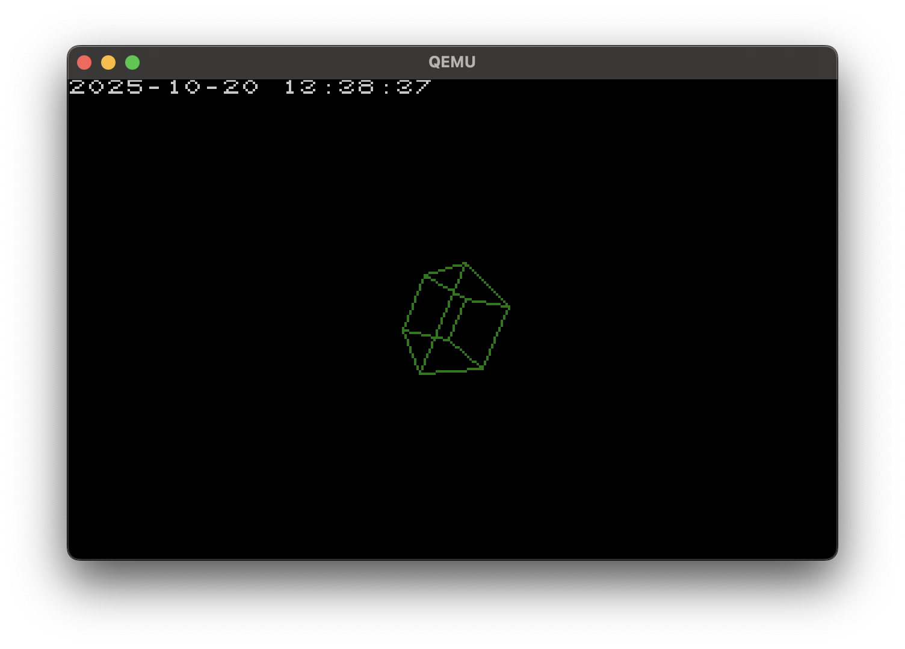
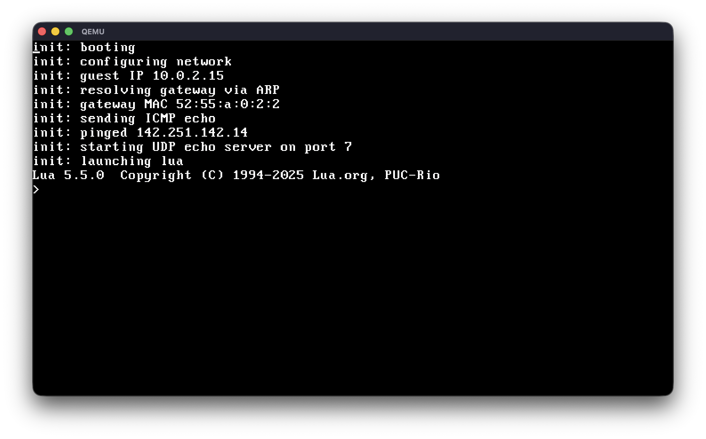

# mboot

Minimal x86 (i386) operating system that boots from BIOS, enters 32-bit protected mode, and runs ELF userspace programs from a FAT16 partition. Includes preemptive scheduling, paging, a VFS, PS/2 + VGA + serial I/O, ATA disk, PCI/e1000 networking (IPv4/UDP/ICMP), and a ported Lua 5.5 userspace.

> **Sources and references:** see [`SOURCES.md`](SOURCES.md) for datasheets, specs, and tutorials used (Intel SDM, OSDev Wiki, FAT/ELF specs, RFCs, etc.).

## Table of Contents

- [Architecture](#architecture)
- [Boot Flow](#boot-flow)
- [Kernel Subsystems](#kernel-subsystems)
- [Userspace](#userspace)
- [Networking Demo](#networking-demo)
- [Prerequisites](#prerequisites)
- [Building](#building)
- [Running](#running)
- [Project Layout](#project-layout)
- [Screenshots](#screenshots)
- [Roadmap](#roadmap)
- [Known Limitations](#known-limitations)

## Architecture

```
BIOS (16-bit real mode)
  └─ stage1/boot.asm (MBR @ 0x7C00) ── BIOS int 0x13 load ─┐
                                                           ▼
                                          0x10000: kernel.bin (stage2)
                                          ┌──────────────────────────┐
                                          │ loader.c: loader_start() │
                                          │  PIC remap, IDT, PIT,    │
                                          │  FPU, serial, E820 mem,  │
                                          │  paging (4 MiB identity),│
                                          │  PCI, net, GDT/TSS,      │
                                          │  scheduler, FAT16, init  │
                                          └──────────┬───────────────┘
                                                     │ spawn_elf("/init.elf")
                                                     ▼
                                          userspace (ring 0, paged)
                                          init → getty ×4 → Lua / ping / UDP echo
```

* Target: `i386-elf`, 32-bit protected mode, identity-paged with 4 MiB pages (`paging.c`), per-process 4 KiB page tables on `exec`/`fork`.
* No long mode / no SMP. All code runs at CPL 0; isolation is via paging (`PAGE_USER`) and `TSS.esp0`.
* Syscalls via `int 0x80` (`idt.c:177`), dispatched in `syscall_dispatch` (`stage2/cpu/interrupts/idt.c:14`).

## Boot Flow

1. **MBR** (`stage1/boot.asm:1`): BIOS loads sector 0 to `0x7C00`. Saves `DL` boot drive, clears screen (`int 0x10 AH=0x00`), detects memory via `int 0x15 EAX=0xE820` (`stage1/boot.asm:19`), loads `kernel.bin` sectors after the MBR via `int 0x13 AH=0x02` (`stage1/boot.asm:84`), enables A20 (`port 0x92`), loads GDT (`stage1/gdt.asm`) and enters protected mode (`CR0.PE`).
2. **Trampoline** (`stage2/start_loader.asm`): sets flat segments `0x08/0x10`, stack at `0x90000`, calls `loader_start`.
3. **Kernel init** (`stage2/loader.c:32`): masks PIC, `pic_remap` to `0x20/0x28`, `idt_init`, exception ISRs, `pit_init` (divisor 1193 → ~1000 Hz), `enable_fpu`, keyboard/serial, `cpuid_init`, `init_alloc` from E820 map at `0x71000/0x70FF0`, `tty_init`, `paging_init`, `pci_enumerate`, `net_init`, `gdt_init` + `ltr`, `scheduler_init`, `fat16_init`, then `spawn_elf("/init.elf")` and `hlt` idle loop.

Disk image (`image.sh`): `boot.bin` written to LBA 0, MBR partition table at `0x1BE` (P1 boot stub + P2 type `0x06` FAT16), `mkfs.fat -F16` on P2 and `mcopy` of `build/*.elf` and test files.

## Kernel Subsystems

| Subsystem | Files | Notes |
|---|---|---|
| **CPU / GDT / TSS** | `stage2/cpu/gdt.c:19`, `inc/cpu/gdt.h` | Flat 4 GiB segments `0x9A/0x92`, TSS for `esp0` on interrupt |
| **Interrupts** | `stage2/cpu/interrupts/idt.c:158`, `isr.asm`, `irq.asm`, `isr.c`, `irq.c` | 256-entry IDT, gate `0x80:DPL3=0xEF`, EOI via PIC |
| **PIC 8259A** | `stage2/cpu/pic/pic.c:31` | Remap `0x20/0x28`, mask per IRQ, cascade on IRQ2 |
| **PIT 8253** | `stage2/cpu/pit/pit.c:4` | Mode 2, channel 0, divisor `1193` |
| **Memory** | `stage2/mem.c:73`, `inc/mem.h` | E820 biggest usable region → bump allocator + free-list (`kmalloc`/`kfree` with coalesce/split), 8-byte align |
| **Paging** | `stage2/paging.c:40` | `CR4.PSE`, 1024×4 MiB identity; `paging_create_directory`/`paging_map_page`/`paging_clone_directory` for processes |
| **ATA PIO** | `stage2/dev/disk.c:40` | LBA28 PIO, ports `0x1F0/0x3F6`, `insw`, per-disk mutex via `scheduler_block` |
| **MBR / FAT16** | `inc/mbr.h:7`, `stage2/fat16.c:196`, `stage2/vfs.c` | MBR parse, BPB, FAT chain `0xFFF8` EOC, LFN, root + data clusters, VFS driver |
| **ELF32** | `stage2/elf.c:12`, `inc/elf.h` | `PT_LOAD` only, filters `vaddr<0x01000000` artifact, `spawn_elf`/`exec_elf` |
| **Scheduler** | `stage2/scheduler.c:226`, `stage2/sched_switch.asm` | Round-robin, `TCB` linked list, `TASK_READY/RUNNING/BLOCKED/EXITED`, `fork_current` clones page tables, `exec_replace` builds new address space |
| **VGA / TTY / Keyboard / Serial / RTC** | `stage2/dev/vga.c:8`, `tty.c`, `keyboard.c:45`, `serial.c`, `rtc.c` | VGA text `0xB8000`, cursor `0x3D4/0x3D5`, scancode set 1, 16550 UART, 4 TTYs |
| **PCI / e1000** | `stage2/dev/pci.c`, `stage2/dev/e1k.c:369` | BAR decode (I/O vs 32/64-bit MMIO), bus mastering, 82540EM TX/RX rings |
| **Net stack** | `stage2/net/eth.c`, `arp.c`, `ipv4.c`, `icmp.c`, `udp.c`, `socket.c:88`, `net.c:7` | Ethernet II, ARP, IPv4 `10.0.2.15/24 gw 10.0.2.2`, ICMP echo, UDP, `AF_INET SOCK_DGRAM/SOCK_RAW` |

## Userspace

* **Toolchain:** `clang -target i386-elf -ffreestanding -fno-pic`, `ld.lld -m elf_i386`, `nasm` (`Makefile:1`, `link.ld:1`). User ELFs linked at `0x40000000+` (`LIBC_LDFLAGS`, `USER_LDFLAGS`).
* **libc** (`user/src/libc.c:1`, `user/include/`): thin `int 0x80` wrappers (`exit=1, fork=2, read=3, write=4, open=5, close=6, waitpid=7, exec=11, ioctl=54, dup2=63, socket=300…`), minimal `string.h`/`stdio.h`/`stdlib.h`/`math.h` (bump `malloc` 64 KiB, no `free`), `setjmp`/`longjmp` via inline asm.
* **Programs:** `user/src/init.c:5` (spawns `getty` on TTY 1-4; `init` stays on TTY1), `user/src/getty.c:3` (→ `execv("/lua.elf")`), `user/lua/` (Lua 5.5.0 supported, code in `user/lua` is the original tar from `https://www.lua.org/ftp/lua-5.5.0.tar.gz`, built via `user/lua/Makefile`), `test_files/ping.c` (raw ICMP), `test_files/udp_lua.c`/`socket_echo.c` (UDP echo), `test_files/fork_test.c`.
* **Syscalls:** `fork` (`scheduler.c:471` copies user pages + `int 0x80` frame), `execv` (`elf.c:81` → `scheduler_exec_replace`), `waitpid`, `read`/`write`/`open`/`close`/`dup2` via VFS, `socket`/`bind`/`sendto`/`recvfrom`, `ioctl(TIOCSCTTY)`.

## Networking Demo

Kernel configures `10.0.2.15/24` via `10.0.2.2` at boot (`stage2/net/net.c:7`). `init` starts `getty.elf` on each tty, which in turn prints a short login string and launches `lua.elf`.

**QEMU with forwarding (host 10007 → guest 7):**

```sh
qemu-system-x86_64 -m 4G -drive file=image.img,format=raw \
  -serial stdio \
  -device e1000,netdev=n0 -netdev user,id=n0,hostfwd=udp::10007-:7 \
  -object filter-dump,id=f1,netdev=n0,file=netdump.pcap
```

**From host:**

```sh
printf 'hello from host\n' | nc -u -w 1 127.0.0.1 10008
```

**Expected serial log:** `NET:`/`IPV4:` bring-up, `ping:` ICMP round-trips, `RX a.b.c.d:src -> 10.0.2.15:7` for UDP.

## Prerequisites

* Build: `clang` + `ld.lld` + `llvm-objcopy` (LLVM ≥ 16), `nasm`, `make`, `mtools` (`mcopy`), `mkfs.fat` (`dosfstools`).
* Run: `qemu-system-x86_64` with `e1000` support.
* macOS: `brew install llvm nasm qemu mtools dosfstools` (ensure `clang` is LLVM clang, not Apple clang wrapper, or set `CC=/opt/homebrew/opt/llvm/bin/clang`).

## Building

```sh
make                 # → kernel.elf / kernel.bin / boot.bin / build/*.elf / image.img
make DEBUG=1         # keep debug symbols in kernel.elf → kernel.sym
make clean
```

Artifacts: `kernel.elf` (linked at `0x10000` via `link.ld:6`), `kernel.bin` (flat binary `incbin`'d in `stage1/boot.asm:146`), `boot.bin` (512-byte MBR + stage2), `image.img` (MBR + FAT16).

## Running

```sh
# headless / serial only
qemu-system-x86_64 -m 4G -drive file=image.img,format=raw -serial stdio -display none

# with networking (no forward)
qemu-system-x86_64 -m 4G -drive file=image.img,format=raw -serial stdio \
  -device e1000,netdev=n0 -netdev user,id=n0

# with UDP forward + pcap (recommended)
qemu-system-x86_64 -m 4G -drive file=image.img,format=raw -serial stdio \
  -device e1000,netdev=n0 -netdev user,id=n0,hostfwd=udp::10007-:7 \
  -object filter-dump,id=f1,netdev=n0,file=netdump.pcap
```

In QEMU: `Alt+1..4` (via TTY handler `keyboard.c:78`) switches TTYs if forwarded through the emulated keyboard; serial `stdio` shows kernel `INFO` logs.

## Project Layout

```
stage1/          BIOS MBR + GDT, disk load, switch to protected mode
stage2/          kernel: loader, cpu/{gdt,cpuid,interrupts,pic,pit}, mem, paging,
                 dev/{disk,serial,vga,tty,keyboard,pci,e1k,rtc},
                 net/{eth,arp,ipv4,icmp,udp,socket,net}, fat16, vfs, elf, scheduler
inc/             kernel headers
user/src/        libc, crt0.s, init, getty
user/lua/        Lua 5.5.0 (vendored)
user/include/    userspace libc headers
test_files/      ping, udp_lua, socket_echo, fork_test, demo programs
tools/           helper scripts
link.ld          kernel link at 0x10000
image.sh         MBR + FAT16 image creation
```

## Screenshots

*2025-10-20 — cube + time demo:*



*2026-08-06 — init + getty + Lua on TTYs:*



## Roadmap

Completed in this capstone:

- [x] 16→32-bit protected mode + GDT/TSS (`stage1/gdt.asm`, `stage2/cpu/gdt.c:19`)
- [x] CPU exceptions + IDT + `int 0x80` syscalls (`stage2/cpu/interrupts/`)
- [x] 8259 PIC remap + per-IRQ handling (`stage2/cpu/pic/pic.c:31`)
- [x] 8253 PIT tick (`stage2/cpu/pit/pit.c:4`)
- [x] PS/2 keyboard scancode set 1 (`stage2/dev/keyboard.c:45`)
- [x] VGA text mode + TTY layer (`stage2/dev/vga.c:8`, `tty.c`)
- [x] 16550 serial / RS232 (`stage2/dev/serial.c`)
- [x] ATA PIO LBA28 disk (`stage2/dev/disk.c:40`)
- [x] MBR partitioning (`inc/mbr.h:7`, `image.sh:72`)
- [x] FAT16 + VFS + LFN (`stage2/fat16.c:196`)
- [x] x87 FPU enable (`loader.c:41`)
- [x] E820 memory map + bump/free-list allocator (`stage2/mem.c:73`)
- [x] 4 MiB identity paging + per-process paging (`stage2/paging.c:40`)
- [x] ELF32 loader (`stage2/elf.c:12`)
- [x] Preemptive scheduler + `fork`/`exec`/`waitpid` (`stage2/scheduler.c:226`)
- [x] PCI enumeration + Intel e1000 driver (`stage2/dev/e1k.c:369`)
- [x] IPv4/ARP/ICMP/UDP + BSD-like sockets (`stage2/net/`)
- [x] Userspace: `init`/`getty`/Lua/ping/UDP echo demos (`user/src/init.c:5`)

Partial / known gaps:

- [ ] **libc** — `user/src/libc.c:1` is a minimal freestanding subset: bump `malloc` (64 KiB, no `free`/`realloc` correctness), no `fseek`/`ftell`, stub `time`/`mktime`, no `pthread`/`errno` thread-safety. Suitable for Lua + demos, not POSIX-complete.
- [ ] **File I/O** — FAT16 read-only (`fat16.c:374` `write=-1`), no directories beyond root, no `unlink`/`rename`.

Planned / out-of-scope for this capstone:

- [ ] filesystem write support
- [ ] Proper `sbrk`/`mmap` + `free` in kernel and userspace

## Known Limitations

* All tasks run at ring 0; process isolation relies only on paging and `TSS.esp0` — no user-mode privilege separation.
* Single-core, no APIC; PIC only. Timer is PIT, not LAPIC timer.
* Network is guest `10.0.2.15/24` via QEMU user-mode NAT; no DHCP client, address is hardcoded (`stage2/net/net.c:7`).
* Disk is PIO without DMA or interrupts; busy-waits on `0x1F7`.

## References

Full bibliography with URLs and spec chapters: [`SOURCES.md`](SOURCES.md).
